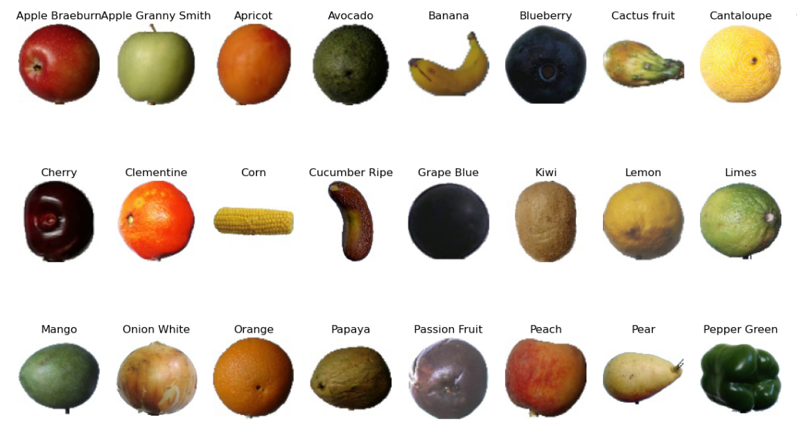
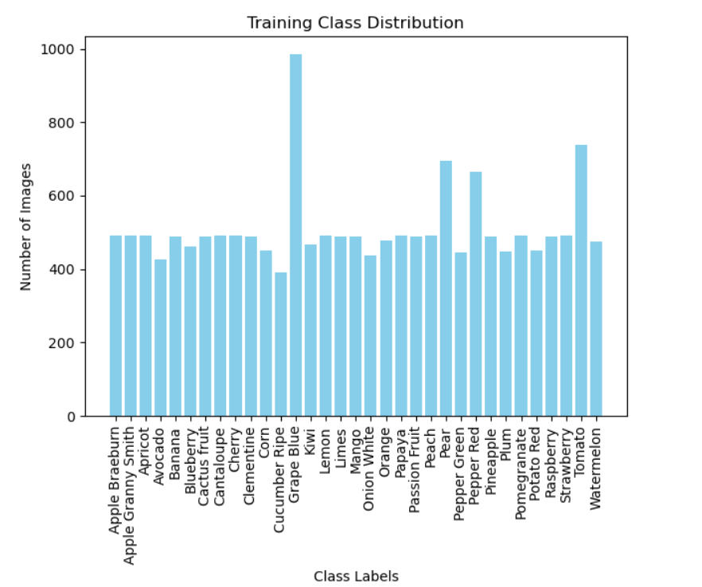
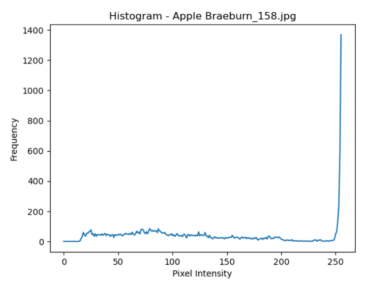
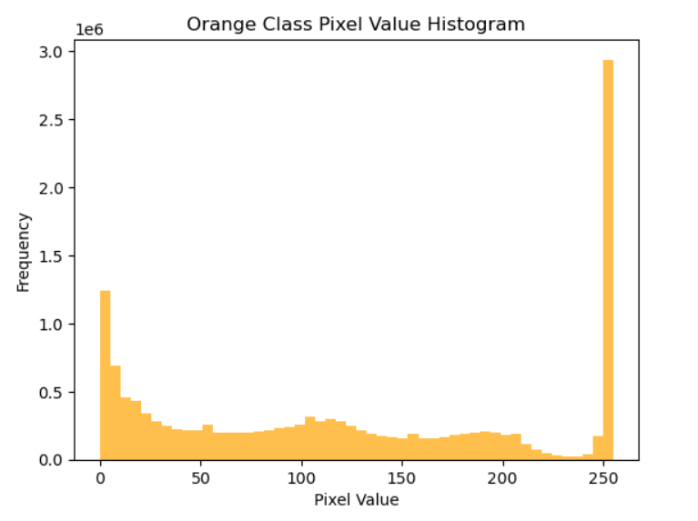
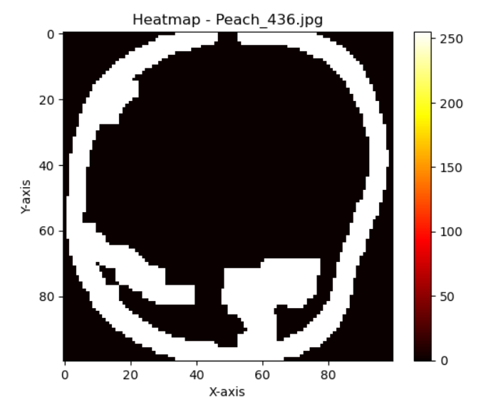
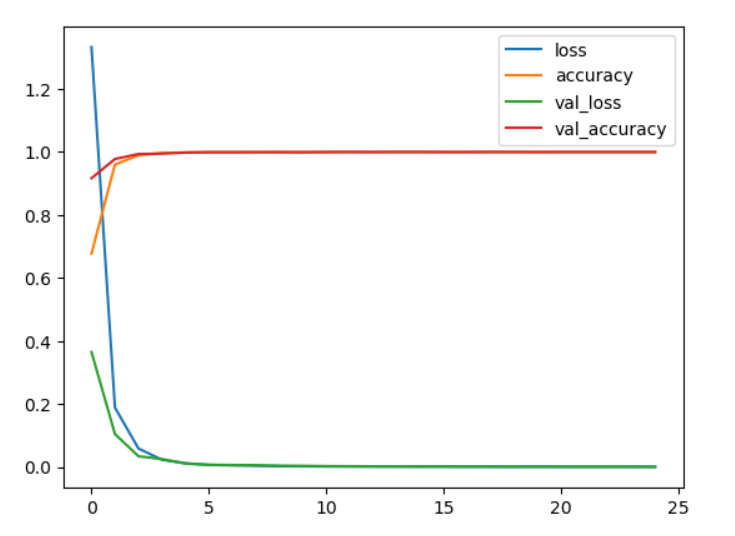

<div align="center">

# 🍎 FruitSelection
### Deep Learning | Computer Vision | Image Classification

**An intelligent fruit classification project using Convolutional Neural Networks (CNN), Python, and TensorFlow/Keras.**

[](https://www.python.org/)
[](https://www.tensorflow.org/)
[](https://keras.io/)
[](https://opencv.org/)
[](https://jupyter.org/)

[Explore Notebook](Fruit_Classification.ipynb) •
[View Trained Model](model.h5) •
[GitHub Repository](https://github.com/sm292/FruitSelection)

</div>

---

## 📌 Project Overview

FruitSelection is a Deep Learning-based Computer Vision project designed to explore automated fruit image classification using Convolutional Neural Networks (CNN).

The project focuses on analyzing fruit images, understanding image characteristics, preprocessing visual data, and developing a classification model capable of recognizing multiple fruit categories.

It combines image processing, exploratory data analysis, visualization, and deep learning to demonstrate how AI can support automated fruit recognition.

### 🎯 Project Objectives

- Develop a CNN-based fruit image classification model.
- Explore image datasets and class distributions.
- Perform image preprocessing and pixel-level analysis.
- Understand visual patterns through histograms and heatmaps.
- Train and evaluate a deep learning model.
- Save the trained model for future inference.
- Explore practical applications of Computer Vision in agriculture and food processing.

---

## 📸 Project Visualizations

### 1. Fruit Classification – Class Definition

Visual representation of the different fruit categories included in the classification dataset.

<p align="center">
  
</p>

### 2. Training Dataset – Class Distribution

Analysis of the distribution of fruit images across different classes.

<p align="center">
  
</p>

**Key observation:** The distribution visualization helps identify differences in the number of available training images across fruit categories.

### 3. Image Pixel Analysis – Apple

Pixel intensity distribution of an Apple Braeburn image, illustrating the variation in image pixel values.

<p align="center">
  
</p>

### 4. Orange Class – Pixel Value Distribution

Visualization of pixel intensity distribution for the Orange class.

<p align="center">
  
</p>

### 5. Image Heatmap – Peach

A heatmap visualization of a Peach image showing spatial pixel intensity variations.

<p align="center">
  
</p>

### 6. CNN Model – Training and Testing Performance

Training and validation accuracy and loss across 25 epochs.

<p align="center">
  
</p>

**Performance observations:**
- Training accuracy increases rapidly during the initial epochs.
- Validation accuracy approaches 100% in the recorded training history.
- Training and validation losses decrease significantly.
- Further independent testing is recommended to assess generalization.

---

## 📊 Dataset Overview

The project uses the Fruit Recognition dataset.

**Dataset Source:** [Kaggle – Fruit Recognition](https://www.kaggle.com/datasets/sshikamaru/fruit-recognition)

| Dataset Component | Description |
|---|---|
| Data Type | Digital fruit images |
| Classification | Multiclass image classification |
| Input | RGB images |
| Image Processing | Resizing and pixel analysis |
| Target | Fruit category |
| Learning Approach | Supervised Deep Learning |

The dataset covers different fruit and produce categories, including apples, bananas, oranges, grapes, mangoes, strawberries, and more.

---

## 🧠 Deep Learning Approach

The project explores a Convolutional Neural Network (CNN) for image classification.

### Model Development Workflow

```text
Fruit Image Dataset
        |
        ▼
Image Loading
        |
        ▼
Exploratory Data Analysis
        |
        ▼
Image Preprocessing
        |
        ▼
Feature Extraction
        |
        ▼
CNN Architecture
        |
        ▼
Model Training
        |
        ▼
Performance Evaluation
        |
        ▼
Saved Model (model.h5)
        |
        ▼
Fruit Classification
```

### Model Training

| Parameter | Description |
|---|---|
| Model | Convolutional Neural Network |
| Framework | TensorFlow / Keras |
| Optimizer | Adam |
| Loss Function | Categorical Crossentropy |
| Output | Multiclass classification |
| Training Epochs | 25 |
| Batch Size | 128 |

---

## 📈 Training Performance

The recorded training visualization demonstrates the following trends:

| Metric | Observation |
|---|---|
| Training Accuracy | Approaches 100% |
| Validation Accuracy | Approaches 100% |
| Training Loss | Decreases significantly |
| Validation Loss | Decreases significantly |

*These are observations from the recorded training curves, not a substitute for independent test-set evaluation.*

---

## 🛠️ Technology Stack

| Technology | Application |
|---|---|
| Python | Programming |
| TensorFlow | Deep Learning |
| Keras | Neural Network Development |
| NumPy | Numerical Computation |
| Pandas | Data Manipulation |
| Matplotlib | Data Visualization |
| Seaborn | Statistical Visualization |
| OpenCV | Image Processing |
| Scikit-learn | Machine Learning Utilities |
| Jupyter Notebook | Model Development |

---

## 📁 Repository Structure

```text
FruitSelection/
│
├── Fruit_Classification.ipynb
│
├── model.h5
│
├── class-definition.png
│
├── heat-map-peach.png
│
├── histogram-apple.png
│
├── orange-class-pixel-value.png
│
├── training-class-domain.png
│
├── training-testing-accuracy-measures.png
│
└── README.md
```

---

## 🚀 Installation & Execution

### 1. Clone the repository

```bash
git clone https://github.com/sm292/FruitSelection.git

cd FruitSelection
```

### 2. Create a virtual environment

```bash
python -m venv venv
```

Activate on Windows:

```bash
venv\Scripts\activate
```

### 3. Install dependencies

```bash
pip install tensorflow numpy pandas matplotlib seaborn scikit-learn opencv-python pillow jupyter
```

### 4. Launch Jupyter Notebook

```bash
jupyter notebook Fruit_Classification.ipynb
```

Run the notebook cells sequentially after configuring the dataset paths.

---

## 💾 Saved Deep Learning Model

The repository includes the trained model:

**`model.h5`**

Load the model using TensorFlow:

```python
from tensorflow.keras.models import load_model

model = load_model("model.h5")

model.summary()
```

The model can be used for further experimentation and compatible image classification workflows.

---

## 🌍 Real-World Applications

| Industry | Potential Application |
|---|---|
| Agriculture | Automated fruit recognition |
| Food Processing | Fruit sorting and categorization |
| Retail | Automated produce identification |
| Inventory Management | Fruit category recognition |
| Quality Inspection | Computer vision-assisted inspection |
| Agricultural Research | Image-based fruit analysis |

---

## 🔮 Future Enhancements

- [ ] Develop an interactive Streamlit application.
- [ ] Implement real-time fruit recognition using a webcam.
- [ ] Add image upload and prediction functionality.
- [ ] Display prediction confidence scores.
- [ ] Generate a confusion matrix and classification report.
- [ ] Experiment with MobileNetV2 and EfficientNet.
- [ ] Improve model generalization.
- [ ] Deploy the model as an interactive web application.

---

## 🎓 Skills Demonstrated

`Python` `Deep Learning` `Machine Learning` `Computer Vision` `CNN` `TensorFlow` `Keras` `Image Processing` `Image Classification` `Exploratory Data Analysis` `Data Visualization` `Neural Networks`

---

## 👨‍💻 Author

**Sumit Mondal**

Data Science | Machine Learning | Deep Learning | Computer Vision

- GitHub: [@sm292](https://github.com/sm292)
- Project: [FruitSelection](https://github.com/sm292/FruitSelection)

---

<div align="center">

### ⭐ If you find this project useful, consider giving it a star!

**Building intelligent solutions through Data Science and Artificial Intelligence.**

</div>
